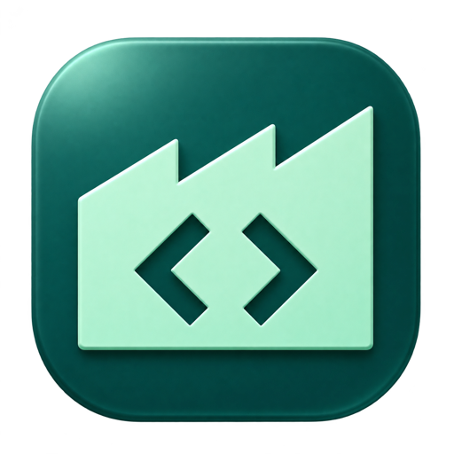
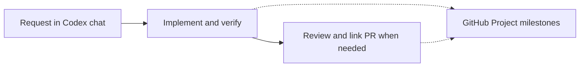

<div align="center">



<h1>SFC</h1>

<p><strong>Track work from Codex chat on your GitHub Project.</strong></p>

<p>Record the features, fixes, checks and reviews that happen in chat.</p>

<p><strong><a href="https://fhajjej-ship-it.github.io/sfc-codex/">Open the SFC website</a></strong></p>

<p>
<a href="#install-in-one-command">Install</a> ·
<a href="#quick-start">Quick start</a> ·
<a href="#how-it-works">Workflow</a> ·
<a href="https://fhajjej-ship-it.github.io/sfc-codex/#skill-map">Skill map</a> ·
<a href="https://fhajjej-ship-it.github.io/sfc-codex/#board-demo">Board demo</a> ·
<a href="https://github.com/fhajjej-ship-it/sfc-codex/releases/latest">Releases</a> ·
<a href="https://github.com/fhajjej-ship-it/sfc-codex/issues/new/choose">Share feedback</a>
</p>

</div>



SFC **0.2.3** is available as a local Codex plugin.

## Install in one command

Installation uses Python 3.10 or newer and the Codex CLI. This fetches the installer
from the release tag, verifies the release ZIP against its checksum, and runs
the bundled Codex installer. You can [read the installer](scripts/install_release.py)
before running it. Stop any active SFC watcher before upgrading.

```bash
curl -fsSLo sfc-install.py https://raw.githubusercontent.com/fhajjej-ship-it/sfc-codex/v0.2.3/scripts/install_release.py && python3 sfc-install.py --version 0.2.3
```

Reopen Codex after installation and review the SFC hooks in `/hooks`. Start with
the onboarding steps below.

## Quick start

Requires Codex, Python 3.10+, Git, and GitHub CLI authenticated with access
to your repository and Project.

1. Open the target repository in Codex and review the SFC hooks in `/hooks`.
   For an existing SFC project, the plugin uses the saved configuration.
2. For a new project, ask Codex to set it up with your GitHub Project owner,
   number and base branch. For example:

   ```text
   Set up SFC tracking for GitHub Project 12 owned by my-org.
   Use main as the base and npm test as the project check.
   ```

   If GitHub asks you to save the column grouping, set **Column by → SFC Status**
   in the board view, then ask Codex to verify it.
3. Ask Codex to fix a bug or build a feature in the project chat. SFC links the
   issue and shows actual progress as the chat works.

**Manual installation.** Download `sfc-0.2.3.zip` and
`sfc-0.2.3.zip.sha256` from the
[release assets](https://github.com/fhajjej-ship-it/sfc-codex/releases/latest).
In the download directory, run:

```sh
shasum -a 256 -c sfc-0.2.3.zip.sha256
unzip sfc-0.2.3.zip
cd sfc
python3 scripts/install_codex_plugin.py
```

Keep the extracted directory as the installer's registered source.

## Use with Claude Code

SFC chat tracking also works in Claude Code. A Claude Code layout is built from
this source; there is no Claude release asset yet. From a checkout:

```sh
python3 scripts/package_plugin.py --claude
claude plugin marketplace add "$PWD/dist/sfc-0.2.3-claude"
claude plugin install sfc@sfc-marketplace
```

Restart Claude Code and review the SFC hooks in `/hooks`. Setup and tracking
work the same way as in Codex. Requires Claude Code, Python 3.10+, Git and an
authenticated GitHub CLI. `track merge` still needs the Codex CLI for its
independent review; see [SFC for Claude Code](docs/CLAUDE-CODE.md).

## How it works

| Board stage | What happened in Codex |
|---|---|
| Building | The chat started work on a feature, bug fix or maintenance task. |
| QA | The chat ran project checks or verified the requested behavior. |
| Review | The chat is reviewing the change, with a linked PR when one exists. |
| Blocked | A specific blocker prevents the chat from proceeding. |
| Done | The linked PR merged, or a change intended for local delivery was verified. |

The current chat's model handles the work. You can ask it to open a PR and link
it to the issue. Merge and release follow your repository's normal process.
SFC remembers pending board updates during GitHub outages so work can continue.

See the [chat tracking guide](docs/CHAT-TRACKING.md) for setup and progress
tracking, and the [work types guide](docs/WORK-TYPES.md) for issue labels.

## Support

Open a [GitHub issue](https://github.com/fhajjej-ship-it/sfc-codex/issues/new/choose) for
installation or workflow help. Include your SFC and Codex versions, operating system, and the step where you
got stuck. Remove credentials and private repository details from any logs you
share.

See the [contribution guide](https://github.com/fhajjej-ship-it/sfc-codex/blob/main/CONTRIBUTING.md) for testing and proposing changes.

SFC is available under the [MIT License](LICENSE).

## Source development

For the current desktop runtime, use the explicit development installer below.
It exports the reviewed compatibility manifest, asks Codex for its installation
location, then resolves the MCP entry point before the final native install.
It keeps the runtime's working directory in the target project. Directly adding
this portable source checkout does not load its lifecycle hooks on Codex 0.167.
The retained marketplace under `dist/development/` is part of the installation;
keep it until replacing/uninstalling that build. Hook trust remains separate. See
[OpenAI's plugin documentation](https://developers.openai.com/plugins/build/plugins).

```sh
python3 -m unittest discover -s tests -v
python3 scripts/validate_plugin.py
python3 scripts/package_plugin.py
# Explicitly requested local development update, using this app's runtime:
python3 scripts/install_development_plugin.py --codex /absolute/path/to/codex
```

Tests use temporary repositories and fake GitHub/Codex adapters; they require no
GitHub credentials, live project or paid model calls. Packaging creates a ZIP and
SHA-256 sidecar under `dist/` with a top-level `sfc/` folder. It does not publish or
install anything globally. Edit source, never the installed plugin cache.

The installer replaces only `sfc@sfc-local` and its local marketplace registration.
Its temporary bootstrap exposes no hooks, skills or server. It uses the native
installer's reported path, never a guessed cache layout or direct cache edit.
The final immutable `-codex.zip` omits portable root `plugin.json` and resolves
only the MCP launch argument. Runtime files, guards, environment forwarding and
project cwd admission remain unchanged. It grants no hook trust, project watcher
authorization, merge authority or release publication. Partial outcomes retain
their journal and stop; do not repeat installation blindly.
