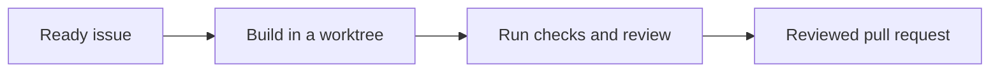
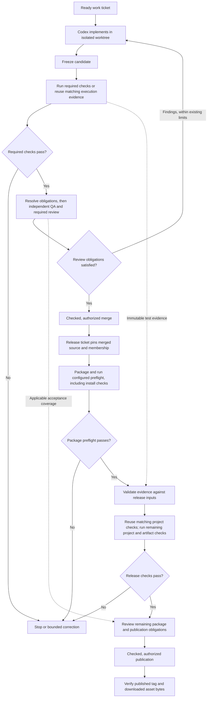

<div align="center">


<h1>SFC</h1>

<p><strong>Turn GitHub Project issues into tested, reviewed pull requests in Codex.</strong></p>

<p>Software Factory Codex builds in isolated worktrees, runs your project checks, and prepares a pull request with independent review.</p>

<p><strong><a href="https://fhajjej-ship-it.github.io/sfc-codex/">Open the SFC website</a></strong></p>

<p>
<a href="#install-in-one-command">Install</a> ·
<a href="#quick-start">Quick start</a> ·
<a href="#how-it-works">Workflow</a> ·
<a href="https://fhajjej-ship-it.github.io/sfc-codex/#skill-map">Skill map</a> ·
<a href="https://fhajjej-ship-it.github.io/sfc-codex/#board-demo">Board demo</a> ·
<a href="https://github.com/fhajjej-ship-it/sfc-codex/releases/latest">Releases</a> ·
<a href="https://github.com/fhajjej-ship-it/sfc-codex/issues/new/choose">Share feedback</a>
</p>

</div>



SFC **0.1.39** is the first public release. Install it as a local Codex plugin.

## Install in one command

Requires Python 3.10 or newer and the Codex CLI. This fetches the installer
from the release tag, verifies the release ZIP against its checksum, and runs
the bundled Codex installer. You can [read the installer](scripts/install_release.py)
before running it. Stop any active SFC watcher before upgrading.

```bash
curl -fsSLo sfc-install.py https://raw.githubusercontent.com/fhajjej-ship-it/sfc-codex/v0.1.39/scripts/install_release.py && python3 sfc-install.py --version 0.1.39
```

Reopen Codex after installation and review the SFC hooks in `/hooks`. Start with
the onboarding steps below.

## Quick start

Requires macOS/Linux, Python 3.10+, git, authenticated GitHub CLI with repository
and Projects access, and an authenticated Codex CLI supporting `exec` with JSON
output schemas. No API key, Claude installation or external helper skill is
required by SFC itself; the target project's own tooling must also work.

1. Get **`sfc-0.1.39.zip`** and **`sfc-0.1.39.zip.sha256`** from the
   [GitHub release assets](https://github.com/fhajjej-ship-it/sfc-codex/releases/latest).
   In the download directory, verify, extract, and install. If you used the
   command above, continue to step 2.

   ```sh
   shasum -a 256 -c sfc-0.1.39.zip.sha256
   unzip sfc-0.1.39.zip
   cd sfc
   python3 scripts/install_codex_plugin.py
   ```

   The installer supports a fresh profile and an existing enabled SFC install.
   It uses Codex's reported installation path to export compatible hooks/MCP,
   with no guessed cache path or direct cache edits. Keep the extracted folder,
   including `dist/native-install/`, which remains Codex's registered source.
   Use `--codex /path/to/codex` when the desktop app uses a different CLI.
   Stop an active factory before upgrading; reopen Codex afterward and review
   the updated hooks. Existing disabled choices are preserved. An existing
   installation journal is a reason to inspect its receipt, not delete it or
   blindly reinstall. See [native packaging](docs/SESSION-RUNTIME.md#current-desktop-packaging).

2. Open a new Codex chat in the **target repository** and ask:

   ```text
   Use SFC to onboard this repository for GitHub Project 12 owned by my-org.
   Use develop as the base, npm ci && npm test and npm run build as verification
   commands. Use automatic merging for eligible PRs in the Ready queue when I
   start the factory.
   ```

   Replace the owner, Project, base and checks with your project's actual values.
   This requests auto policy and merge authority for the selected run scope. Say
   “leave merging to me” instead to choose human merging.
   Complete the returned board setup steps and verify the saved Factory view.

3. Put only authorized issues with concrete `## Acceptance criteria` bullets in
   Ready. In that Codex chat, preview the queue, then explicitly start:

   ```text
   Use SFC to run doctor, lint and a dry run. Show the scope before starting.
   ```

   After reviewing the preview, use `$sfc:sfc run`; use `$sfc:sfc stop` to stop.
   These are skill prompts inside Codex, not shell commands. A real run invokes
   workers, publishes draft PRs and updates the configured board. Use the already
   authorized merge scope with `--allow-merge`. New setup defaults to auto policy;
   existing project choices are preserved. A dry run does not prove builds or remote writes will
   succeed.

Codex lists the plugin as **SFC** after installation. Review the bundled hooks
in Codex's `/hooks` interface before enabling them for your project. For
configuration details, see the [onboarding guide](docs/ONBOARDING.md).

## How it works

SFC runs the work for a ticket in an isolated worktree and records its checks
and review findings. A merge requires current evidence and your merge
authorization. When configured and authorized, the
[release workflow](docs/RELEASES.md) packages merged changes, reuses matching
test or source-review evidence, and verifies the published download.

<details>
<summary>See the workflow from ticket to release</summary>



</details>

## Setup and operating guides

Onboarding writes `.sfc/config.json` in the target repository without overwriting
existing choices. New projects default to
automatically merging eligible reviewed PRs after separate run/watch merge
authorization. Choose `--merge-policy human` (or say “leave merging to me”) for
human merging. Setup alone starts no workers and grants no run scope or merge
authority. Installing/updating, read-only status/doctor and reopening a project
retain saved policies and session budgets. It creates/reuses SFC Status, Priority,
work-type labels and activity fields. Save **View → Column by → SFC Status** and reopen the returned
Factory view URL to verify all seven stages: Backlog, Ready, Building, QA,
Review, Blocked and Done. Field creation alone does not complete board setup.

| Guide | Details |
|---|---|
| [Configuration](docs/CONFIGURATION.md) | Board setup/repair, Priority, worker model/effort/speed, timezones and finite limits |
| [Activity and recovery](docs/ACTIVITY.md) | SFC Agent / SFC Activity reporting, freshness and retained diagnostics |
| [Work types](docs/WORK-TYPES.md) | Bug, Feature, Refactor, Documentation and Maintenance; existing-board upgrades |
| [Scoped Backlog pickup](docs/BACKLOG-PICKUP.md) | Explicit issue allowlists, priority ordering, prerequisites and claim recovery |
| [Foreground watcher](docs/WATCH.md) | Preview, start, status, stop, exclusions, holds and session recovery |
| [Local merge](docs/LOCAL-MERGE.md) | Exact candidate protocol, tradeoffs and uncertain-outcome recovery |
| [Distribution assessment](docs/DISTRIBUTION.md) | Dated public-directory eligibility, hook dependencies and manual-launch recommendation |
| [Capabilities](docs/CAPABILITIES.md) / [design](docs/DESIGN.md) | Supported behavior, architecture and verification ownership |

Ordinary runs select Ready only. Optional `## Blocked by` references name
same-repository prerequisites. Scoped Backlog pickup requires both
`--include-backlog` and repeated `--issue` allowlist entries; preview and execute
with the same authorized scope. Detailed preview rows cover only that selection;
prerequisites outside it are still independently verified.

The [foreground watcher](docs/WATCH.md) polls authorized Backlog and Ready
work within a finite session. Review the scope, exclusions, and hold label before
starting it. Setup and installation alone launch no workers.

On supported macOS hosts, newly onboarded projects can keep watching while an
authorized Codex project chat is open. Trusted hooks attach the local session
runtime. Use `onboard --no-auto-start` to leave it off, or
`--no-session-lifetime` for bounded auto-start. Each window is limited, and
automatic merging requires separate authority. Review the
[session runtime](docs/SESSION-RUNTIME.md) and
[onboarding checklist](docs/ONBOARDING.md) for host support and activation checks.

## Included skills

| Skill | Job |
|---|---|
| `sfc` | Onboard, lint, status, run, resume and stop |
| `sfc-build` | Implement one issue in an isolated worktree |
| `sfc-qa` | Check acceptance criteria, behavior and test gaps |
| `sfc-security` | Review the PR diff for supported vulnerabilities |
| `sfc-review` | Independent correctness and evidence review |
| `sfc-collect` | Investigate, deduplicate and prioritize findings or Backlog issues |
| `sfc-ui-refine` | Critique, improve and visually verify a selected UI |
| `sfc-visual` | Generate a standalone HTML recap, plan or codebase map |
| `sfc-git-sync` | Review, commit, integrate remote changes and push selected work |

The first five implement the queue pipeline. The last four are interactive
workflows using tools in the current chat. Browser access, telemetry and
project-specific databases are not bundled. Ask "Use SFC to prioritize this
project's backlog" to record reasoned priorities, or "suggest priorities only"
for a local readout. Neither authorizes workers or merges. Ticket creation needs
a request to create tickets and uses the bundled verified `create-ticket` path;
see the [priority rubric and creation contract](skills/sfc-collect/references/prioritization.md).

## Merge controls and verification

New-project onboarding defaults to `merge_policy: "auto"`. Explicit
`--merge-policy human` remains available, and existing configurations retain their
saved policy. With human policy or without run merge authority, a verified PR
waits for human review with its card in Blocked; a later run observes the external
merge before Done. QA-labeled issues test the existing base without creating an
implementation PR. Other cards
follow Build → QA → Security → Review.

In supervised builds, builders reproduce relevant failures and run meaningful
focused checks. The supervisor runs configured full verification before
independent QA/security and repeats it for the final merge candidate. Explicit
builder-specific or full-suite project requirements and full runs needed to
reproduce defects still apply. Standalone builds retain project/user verification
obligations. See [verification ownership](docs/DESIGN.md).

Auto-merge requires configured `merge_policy: "auto"` **and** explicit run/session
merge authority (`run --allow-merge` or `watch --allow-merge`). Once authorized
for the selected scope, eligible PRs merge without routine per-PR approval or
repeated requests for the same authority. Default policy does not authorize a new
watcher session or renew a named session's settings, counters or deadline.
Default `merge_mode: "github-protected"`
requires strict up-to-date branch protection and successful GitHub checks.
Explicit `merge_mode: "local-verification"` uses one atomic expected-head-and-base
fast-forward to the exact reviewed head; it preserves history without squashing,
rejects protected/ruled refs and unsupported servers, and has no fallback.

Both modes require unchanged head/base/config/issue evidence, independent QA,
security and final review, repeated project checks, a small diff and no sensitive
labels/paths. The default cap is 400 changed lines. Missing GitHub checks require
a deliberate `allow_no_checks: true`; existing checks still must pass. SFC does
not bypass branch rules or apply live database migrations. Acknowledged exact
merges can use bounded read-only confirmation of GitHub recognition; ambiguous
outcomes retain journals without repeating the merge request. Read the
[merge contract and recovery policy](docs/LOCAL-MERGE.md#bounded-recognition-window).

Local mode journals before writes and verifies actual base/PR/issue outcomes
before Done. External human merges without a local journal require manual
reconciliation in this mode; retain uncertain outcomes for inspection.

Workers use `workspace-write` for Build, `read-only` for other lanes and approval
policy `never`; the supervisor owns commits and GitHub writes. Unavailable tools,
permissions or model settings are reported without silently broadening access or
substituting models. Project checks are local shell commands that may install
dependencies or write artifacts. Use trusted projects and suitable test data:
the factory and literal-command hooks are not a sandbox for hostile code or issues.
Normal plugin use treats installed code and skills as **read-only**. Keep project
configuration and run state in the target repository; maintainer changes belong
in source, distributed as versioned updates.

## Evidence and recovery

Local `.sfc/` state, worktrees and raw receipts are excluded from Git. Lane
receipts pin the reviewed head, base, configuration and task. Failed checks,
malformed worker results, timeouts, stale heads, auth/rate errors or ambiguous
GitHub writes preserve evidence. Writes are not automatically retried. `stop`
terminates only child process groups owned by the active supervisor.

Default limits: two concurrent cards, 20 ticket admissions, three tickets without
terminal/stage/evidence progress, two failing attempts per issue, 20 minutes
per worker and 15 minutes per verification command. Limits must stay positive;
watchers also have finite time/poll/claim budgets. Waiting is not Done.
See [rolling priority admission and accounting](docs/SCHEDULING.md) for slot
refill, conservative interruption spending and unchanged authority boundaries.

After ambiguity, inspect GitHub and `.sfc/state.json` before restarting. Never
delete worktrees, clear state or reset branches to force recovery. An in-flight
card without a saved claim requires explicit recovery. A successful new preflight
clears only the current-run error when a real run starts; prior diagnostics stay
in `.sfc/runs/<run_id>/`. Read-only status and dry runs do not clear them. See
[claim recovery](docs/BACKLOG-PICKUP.md), [watch recovery](docs/WATCH.md) and
[merge recovery](docs/LOCAL-MERGE.md).

For current evidence and its limits, see the
[verification and review qualification](docs/DELIVERY-QUALIFICATION.md) and
[published releases](https://github.com/fhajjej-ship-it/sfc-codex/releases).

## Support

Open a [GitHub issue](https://github.com/fhajjej-ship-it/sfc-codex/issues/new/choose) for
installation or workflow help. Include your SFC and Codex versions, operating system, and the step where you
got stuck. Remove credentials and private repository details from any logs you
share.

See the [contribution guide](https://github.com/fhajjej-ship-it/sfc-codex/blob/main/CONTRIBUTING.md) for testing and proposing changes.

SFC is available under the [MIT License](LICENSE).

## Source development

For the current desktop runtime, use the explicit development installer below.
It exports the reviewed compatibility manifest, asks Codex for its installation
location, then resolves the MCP entry point before the final native install.
It keeps the runtime's working directory in the target project. Directly adding
this portable source checkout does not load its lifecycle hooks on Codex 0.167.
The retained marketplace under `dist/development/` is part of the installation;
keep it until replacing/uninstalling that build. Hook trust remains separate. See
[OpenAI's plugin documentation](https://developers.openai.com/plugins/build/plugins).

```sh
python3 -m unittest discover -s tests -v
python3 scripts/validate_plugin.py
python3 scripts/package_plugin.py
# Explicitly requested local development update, using this app's runtime:
python3 scripts/install_development_plugin.py --codex /absolute/path/to/codex
```

Tests use temporary repositories and fake GitHub/Codex adapters; they require no
GitHub credentials, live project or paid model calls. Packaging creates a ZIP and
SHA-256 sidecar under `dist/` with a top-level `sfc/` folder. It does not publish or
install anything globally. Edit source, never the installed plugin cache.

The installer replaces only `sfc@sfc-local` and its local marketplace registration.
Its temporary bootstrap exposes no hooks, skills or server. It uses the native
installer's reported path, never a guessed cache layout or direct cache edit.
The final immutable `-codex.zip` omits portable root `plugin.json` and resolves
only the MCP launch argument. Runtime files, guards, environment forwarding and
project cwd admission remain unchanged. It grants no hook trust, project watcher
authorization, merge authority or release publication. Partial outcomes retain
their journal and stop; do not repeat installation blindly.
