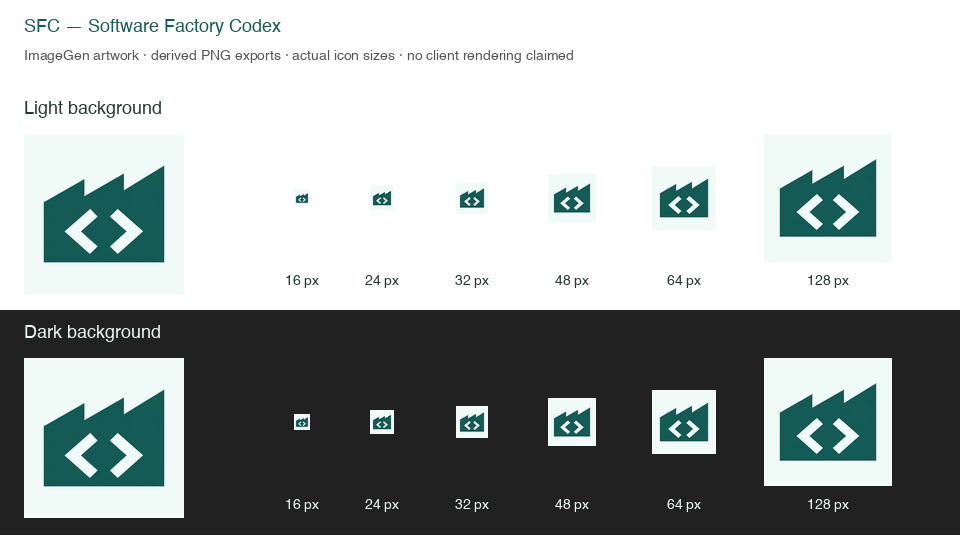

# SFC logo — Software Factory Codex

The mark combines a factory roof and code chevrons. The plugin display name
remains **SFC** and its identifier remains `sfc`. This branding was introduced
during 0.1.12 development and is included in the current plugin package.

## Website icon

The [homepage icon](../assets/sfc-app-icon.png) also appears at the top of the
GitHub README. The ImageGen edit kept the three factory roof peaks and central
code chevrons, with a pale mint inlay on a rounded evergreen-teal tile. The
512-pixel PNG retains its transparent corners.

## Reusable assets

| File | Purpose |
| --- | --- |
| [Transparent master](../assets/sfc-logo-master.png) | Original native Codex ImageGen output, 1254 × 1254 RGBA PNG; retained unchanged as the high-resolution raster source |
| [Logo](../assets/sfc-logo.png) | 512 × 512 RGB PNG for the plugin listing and README |
| [Composer icon](../assets/sfc-icon.png) | 64 × 64 RGB PNG for the composer |
| [Contact sheet](assets/sfc-logo-preview.png) | Light/dark preview at 16, 24, 32, 48, 64 and 128 px, plus enlarged examples |

The two UI exports share a pale mint (`#F0FAF7`) square background so the teal
artwork stays visible on both light and dark surfaces without client-specific
theme switching. Transparency is preserved in the master. The 16 px example
has limited roof detail; the factory silhouette and chevrons are clearer from
24 px upward. The packaged composer asset itself is 64 px, above the documented
48 px minimum. The contact sheet is an export preview, not a screenshot of Codex.

## Provenance and export

Created November 8, 2026 using the **native Codex `image_gen` tool**, with
`transparent_background: true`. No stock art, programmatic replacement logo,
API-key fallback or borrowed company logo was used. The saved original output
was `exec-ed8d07ab-973c-4a2f-980b-9aabec5e167e.png`; the reusable copy is the
master linked above, byte-identical to that output (SHA-256
`28d76562a3b2dd848a6e74c5e0428ea9c4cadd37fb4857e14d33b6d46a830fe3`).
It is a raster master, not an editable vector drawing.

Final generation prompt:

> Use case: logo-brand. Create one original logo mark for SFC, Software Factory Codex, a Codex-only software factory plugin. Asset: square plugin icon and reusable high-resolution master. A single bold geometric factory silhouette integrated with two simple code chevrons in negative space: three stepped roof sections, solid rectangular lower body, centered clear <> opening. Restrained flat vector-like aesthetic, clean antialiased edges, deep teal #145C54 as the single ink color. No text, no initials, no gradients, no shadows, no outlines, no small windows, no decorative circuitry. Recognizable at 24-32px, thick forms with generous clear spacing. Center the mark with about 12% transparent padding on every side, square composition. Genuinely transparent background. Do not imitate any existing company logo or OpenAI's logo. Deliver a single isolated mark, no mockup or contact sheet.

Derivative exports use Pillow (a maintainer asset tool, not a runtime dependency):
locate the master's alpha ≥ 8 bounds `(196, 289, 1058, 981)`, crop with 4 px
bleed `(192, 285, 1062, 985)`, fit within 390 × 390 using Lanczos (390 × 314), center on
a 512 × 512 mint canvas, and export RGB PNG. Resize that export to 64 × 64 with
Lanczos for the composer. This preserves the generated contours and color;
no logo geometry is drawn. The contact sheet uses those actual exported assets.

## Plugin integration and verification boundary

The [official OpenAI listing metadata reference](https://developers.openai.com/plugins/deploy/submission#listing-metadata)
supports `logo` and `composerIcon` in `extensions.com.openai.interface` for
Agent Plugins and `interface` for the Codex format. The
[icon requirements](https://developers.openai.com/plugins/deploy/submission#icons)
specify `./` paths from the plugin root, square images at least 48 px, PNG support,
and a maximum of 5 MiB per image. Both manifests reference the same local files.
`scripts/package_plugin.py` includes the `assets` directory and this documentation.

Checked against the official pages on November 8, 2026 and the locally generated
**codex-cli 0.167.0** app-server JSON schema: `PluginInterface` exposes `logo` and
`composerIcon` as resolved local package paths, and `logoDark` as an optional
local dark-mode logo. That client's response schema does not expose
`composerIconDark`, although current official documentation lists it. No such
field is needed or added here. Schema inspection establishes protocol support,
not that a particular desktop client renders the assets.

Builder checks cover PNG decoding, sizes/alpha, referenced paths, archive CRC,
packaged asset byte equality, and visual inspection of the contact sheet.
The package command also invokes its existing internal package validator.
The supervisor owns the configured full unittest suite and standalone plugin
validator before independent QA and at the final candidate. No full-suite pass
is claimed by this builder.

Human design approval has **not** been received. No installation, release,
published-asset replacement or real installed-client visual check was performed.
After authorized integration/installation, a maintainer can inspect the plugin
listing and composer in Codex on light/dark themes. That later smoke check is
separate from pre-merge asset/package QA.
