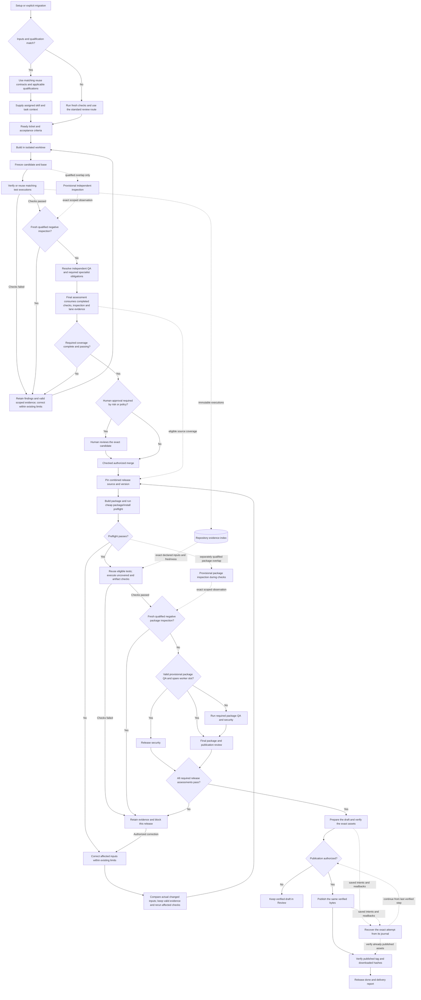

# Delivery efficiency

SFC separates original execution evidence from the decision to accept it for a
new candidate. Passing a test once can satisfy another ticket only when its
declared inputs still match. Merge and publication retain their own authority.
The package that users download still receives package and installation checks.

## Supported setup

New `onboard` detects the SFC Python/plugin layout and supports the exact
commands `python3 tests/run_suite.py` or `python3 -m unittest discover -s tests -v`
for the suite, and `python3 scripts/validate_plugin.py` for the plugin validator.
SFC's maintainers can select the parallel suite for work and release checks. It
runs the same unittest discovery groups in up to four processes by default and fails if
discovery changes, any group fails, or the executed count differs. When
switching an existing project, replace the suite command, remove its old
reuse contract and preview a new contract for the parallel command.
The `sfc-python` profile binds the complete
source tree, Python executable and standard library, Git executable, declared
environment, artifact state and a one-hour freshness limit. It assumes these
commands use only source and the standard library, without network, Git history,
task-specific context or undeclared dependencies. The operator confirms those
assumptions. Detected dependency manifests or unavailable toolchain inputs keep
checks fresh. Use `--efficiency-profile off` for projects that cannot satisfy
the contract. Other commands retain fresh execution and show an unsupported
check ID.

For existing projects:

```sh
python3 scripts/sfc.py --root <project> efficiency-profile
python3 scripts/sfc.py --root <project> efficiency-profile --apply --expected-digest <preview-config-digest> --expected-proposed-digest <preview-proposed-digest>
```

Preview is read-only. Apply holds the supervisor lock, pins the exact preview
and retains the original configuration and migration intent. Explicit contracts,
worker choices and authority are preserved. Re-arm an existing watcher explicitly
after configuration changes. `doctor`, `status` and onboarding show the configured
checks and qualification decisions. `status` also counts executed, reused and
failed checks from the latest verification receipt for each ticket under the
current configuration.

For the SFC maintainer repository, preview with
`efficiency-profile --profile sfc-python-docs` and apply with the same profile
and the two preview digests. This profile replaces the standard suite with
two checks whose discovery groups cover the full unittest suite. The first
executes selected runtime tests in a snapshot that omits regular Markdown
directly under `docs/`. The remaining tests confirm that the snapshot and the
complete checkout discover the same runtime test IDs. They and the plugin
validator read the complete candidate.

The unified new-project review selects `sfc-python-docs` automatically for this
supported partitioned suite, unless doing so would invalidate an already
qualified review route. `setup-defaults` offers the same explicit migration for
existing projects while retaining saved opt-outs. The older `efficiency-profile`
entry point still requires selecting `sfc-python-docs` explicitly, even if the
configuration already lists the split commands. The migration rejects custom
verification contracts and refuses to renumber checks referenced by behavioral
or correction review rules.

Run `sfc doctor` for the configured project and look for the top-level
`documentation_independent_check_count` field in its JSON output. With
`sfc-python-docs` applied, the count is `1` for the runtime check. The count
shows how many checks are eligible for evidence reuse under the configuration
when only the contents of those existing Markdown files change. Actual reuse
requires valid, matching evidence. For the current run, inspect the `checks`
entries in the ticket's verification receipt at
`.sfc/runs/<run-id>/issue-<number>/verify-*/receipt.json`. A reused entry has a
`reuse` field that points to the original execution receipt.

File additions, removals, mode changes, and changes to other inputs
require fresh execution. The profile fixes the declared tool search path,
locale, time zone and Python hash seed at setup, so desktop and terminal
processes use the same inputs. The supervisor still verifies the current
checkout and the original logs, binds each accepted check to the current
candidate, and requires independent review. The release package, its docs,
and its installation checks use the exact release candidate.

Normal setup and an applied efficiency migration scope worker prompts to their
assigned skill and current task, including projects without a reuse profile, by setting
`worker_runtime.skill_catalog` and `worker_runtime.memories` to `false`. These
invocation-only options omit the automatic skills catalog and unrelated personal
memory injection/collection. Repository instructions, explicitly referenced skill
files, available tools, trusted hooks and authentication remain intact. Existing
explicit `worker_runtime` choices, including an empty object, are preserved.
Selecting the `off` profile preserves inherited context settings.
This reduces supplied context; actual delivery savings still require measurement.

The profile prepares a repository-local standard-library Python environment.
Subprocess Python uses the same isolated environment, with system and user site
packages excluded and bytecode writes disabled. Runtime libraries, existing
bytecode, ignored project inputs and actual PATH tool resolution are fingerprinted.
Only declared generated `dist` outputs and supervisor-owned state are excluded
from untracked inputs; tracked source is always bound.

The SFC package verifier moves to early preflight when it is the sole existing
artifact verifier. Custom release commands keep their original ordering. See
[release preflight](RELEASE-PREFLIGHT.md).

### Qualified review and worker settings

Normal setup first considers the package's bundled upstream SFC qualification,
when present. This is a narrow profile for `scripts/sfc_lib/ticket_validation.py`,
not a general approval for arbitrary Python projects. Its certificate binds an
independently adjudicated real-model comparison, full-check activation evidence,
the shipped runtime, Codex provider and CLI, worker settings, both project-check
contracts and repository instructions. The base must descend from the qualified
upstream source; unrelated code, check or instruction changes retain the full
review path. Eligible module changes still receive independent QA and final
review, with security and human escalation whenever required. Every candidate,
base, task, execution and acceptance receipt keeps its own exact validation.
The certificate is trusted only as bundled release data; repository copies or
unverified summaries cannot enable this profile. Setup, migration, status and
the live review gate revalidate it. Missing or mismatched evidence retains the
ordinary three-lane path and reports why. Explicit project review choices win.
Focused review timings are distinct from full delivery measurements; see the
corresponding release results for the measured scope and remaining limits.

The same bundled qualification can carry independently adjudicated evidence for
source inspection, release package inspection, or both. Setup selects each
passing profile only within its measured controls. Release inspection waits for
separately configured release commands, artifacts and publication scope that
match its evidence. An unavailable or mismatched overlap profile leaves the
qualified sequential review route available. Existing explicit inspection
choices are preserved. The normal spare-slot, recent comparable check and
completed final assessment requirements apply to each dispatch.

Both `onboard` and `efficiency-profile` accept optional local qualification
manifests. Supply the same manifest flags when applying a migration preview.
Setup reads and evaluates retained evidence without launching workers.

Pass `--review-qualification <manifest.json>` to propose a new review policy.
The manifest contains the proposed `review_policy` with the existing pinned
comparison references. For example, a source inspection proposal has this shape.

```json
{
  "version": 1,
  "review_policy": {
    "inspection": {
      "enabled": ["source"],
      "promotion": {"path": "inspection-report.json", "sha256": "<sha256>"}
    }
  }
}
```

Paths are relative to the manifest directory or absolute. Setup re-evaluates
every requested route and verifies the matching configuration, worker settings
and runtime. Behavioral qualification also checks its tracked paths and
repository instruction hashes. A later candidate still needs its own pinned
attestation, applicable specialist obligations and final assessment. Existing
explicit review policy is preserved. See [review efficiency](REVIEW-EFFICIENCY.md).

Pass `--model-qualification <manifest.json>` to consider an alternative to the
onboarding worker preset. Use the pinned model-only comparison input, its
independent adjudication and a route digest covered by that comparison.

```json
{
  "version": 1,
  "input": {"path": "qualification-input.json", "sha256": "<sha256>"},
  "adjudication": {"path": "adjudication.json", "sha256": "<sha256>"},
  "target_route": "<covered configuration route sha256>"
}
```

Both profiles must demonstrate acceptance coverage and critical-defect
detection across the full fixture set. The alternative must also meet the
declared latency or usage objective. Setup verifies each measured
source route and, when release is enabled, each publishing case's completed
release route against the target's verification, review, release and finite
budget settings. Draft-only projects use a verified draft and downloaded
installation as their endpoint. These measurements qualify the draft route.
Published-delivery goals require a comparison that reaches publication.
Setup also checks the measured baseline and the matching Codex CLI, user
configuration and worker runtime. Explicit model, effort and tier choices and lane overrides
take priority. Migration can change a preset field only when the saved receipt
for the exact existing configuration records it as an implicit default.
Legacy settings and inheritance are preserved. Unknown, failed or mismatched
qualification leaves the existing settings in effect. Review the recorded
baseline if a previously selected worker profile reports stale evidence or a
changed provider environment. A later model startup rejection uses the normal
failure and recovery rules.

The model-only comparison starts work under normal SFC onboarding with both
supported checks. Publishing cases explicitly configure the release phase after
the work merge. The comparison records separate source and release route
digests and applies outer launch and timeout caps to its temporary fixtures.
Both arms default to the historical 120-second worker cap. For a new comparison,
`tests/benchmark_delivery.py --qualify --worker-timeout-seconds <seconds>` accepts
one integer from 1 to 300 for both arms. The comparison plan records that cap and
the total reserved worker-second ceiling before dispatch. The temporary fixture
cap has no effect on a project's configured worker timeout.
Ordinary setup keeps its preset unless the comparison qualifies its route.

Setup and migration receipts retain local evidence references. Qualification
status shows digests and fixed reasons. Model availability remains subject to
the active account at the time of execution. See
[delivery qualification](DELIVERY-QUALIFICATION.md).

## Execution and acceptance

The repository index contains only references to complete successful immutable
verification receipts. Lookup validates the source receipt, original execution,
raw log, artifact hashes, freshness and input contracts. Missing or damaged
evidence runs the check. Another ticket never inherits approval from the
execution ticket. Its new receipt pins its own head, base, task and configuration
and links directly to the original execution, preserving the original timestamp.

An unchanged combined source can reuse a passing suite; separately passing PRs
do not certify a previously untested combination. Legacy contracts retain their
exact ticket-bound behavior. Legacy or incomplete receipts fall back to execution.

Optional `source_inputs` lists exact tracked files or directories for a check
that is known to read only those paths. File bytes, Git modes, additions, removal,
renames and declared dependencies are inputs. Skills, executable examples and
runtime-consumed text belong in that list when applicable. Unknown dependencies
must use the whole source tree or disable reuse. The supported setup profile
never guesses narrower paths from filename extensions.

## Complete flow



Dashed inspection requires a separately qualified source or package profile,
available worker capacity and representative check duration. Normal setup may
select matching bundled qualification; existing explicit choices are preserved.
Provisional inspection is never a passing final review. After required checks
pass, a fresh qualified negative inspection can reject that exact candidate
without a second QA call. Its immutable finding and check references are retained;
source work follows the existing correction and attempt limits, while a release
is blocked. This rejection supplies no passing QA or merge/publication authority.
For a successful delivery, the final assessment must resolve the inspection
against completed checks. Mandatory risk and acceptance obligations remain.
Qualified routine behavioral changes retain independent QA before final review.
The narrow qualified prose route can consolidate those source obligations.
Release reviewers receive exact private manifest-hash inputs alongside actual
package and installation check logs. They assess prepublication readiness;
the supervisor verifies publication and downloaded bytes afterward.
An unpublished draft stays in Review. An interrupted release resumes from the
same frozen candidate and retained attempt. It verifies remote state before
continuing, and a confirmed publication proceeds to download verification.
See [review efficiency](REVIEW-EFFICIENCY.md) for the precise gate and limits.

## Measurement and claims

`delivery-report` explains executed and reused checks, stage times, original
execution references, retries and available model usage. Unknown billing and
intervention timing remain unknown. A zero-filled native Codex review completion
without token counters is reported as unknown usage. Wall time and summed worker
time differ because parallelism can reduce waiting while increasing total model work.

The proposed 30% lower routine median delivery time and 20% lower comparable
model usage are qualification targets, not guaranteed savings. Offline adapter
tests prove control flow; actual model comparisons are separately identified.
Qualified model and review choices require matching source, configuration,
acceptance coverage and defect outcomes. A failed or incomplete comparison does
not promote a route or reset attempt limits.
